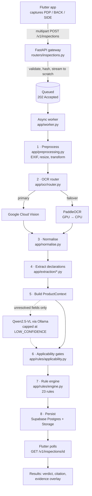

# PackSentry

Automated compliance checking for the **Legal Metrology (Packaged Commodities) Rules, 2011**.

An inspector photographs a retail package's front, back, and optionally side panel. PackSentry
runs OCR over the images, extracts every statutory declaration (net quantity, MRP, manufacturer
address, dates, country of origin, and more), and evaluates them against 23 implemented rules.
Every verdict is returned with the exact statutory citation that justifies it and an evidence
polygon pointing at the pixels it was read from — so a finding can be defended, not just asserted.

The system is deliberately conservative: when the evidence is weak or a rule's precondition is
genuinely ambiguous, it reports `MANUAL_REVIEW` or `INDETERMINATE` rather than guessing at a
non-compliance verdict.

---

## How it works



Two design decisions are worth calling out, because they shape the whole codebase:

- **Rules adjudicate on `raw_text` only.** Normalised text exists purely for matching. This is
  enforced mechanically — `Backend/tests/test_rules_lint.py` walks the AST of every rule module
  and fails the build if one so much as names `normalized_text` or a geometry field.
- **The vision-language model can never convict.** Qwen2.5-VL runs only on fields the
  deterministic parsers could not resolve, its output is provenance-tainted, and it is capped at
  `LOW_CONFIDENCE` — it can never produce a `NON_COMPLIANT` verdict on its own.

---

## Tech stack

| Layer | Technology |
|---|---|
| API | FastAPI, Pydantic v2, uvicorn |
| Worker | In-process `asyncio` queue, single capacity (no Celery/Redis) |
| OCR | Google Cloud Vision (primary) → PaddleOCR 2.x (failover) |
| VLM | Qwen2.5-VL 7B via Ollama, selective fallback only |
| Imaging | OpenCV (headless), NumPy |
| Data | Supabase Postgres (`app` schema) + Supabase Storage |
| Mobile | Flutter, Dart `^3.13.2`, Provider |
| Contracts | `lmpc_schema` Pydantic models → JSON Schema → Dart via quicktype |

PaddleOCR is pinned to `2.x` on purpose: 3.x requires paddlepaddle 3.x, which has no wheel for
the target GPU. See the comment in `Backend/requirements.txt`.

---

## Repository layout

```
PackSentry/
├── Backend/
│   ├── app/
│   │   ├── main.py            FastAPI app, lifespan, local image fallback route
│   │   ├── worker.py          Single-capacity async inspection worker
│   │   ├── routers/           inspections, rules, health
│   │   ├── ocr/               cloud_vision, paddleocr_engine, router, vlm_interpreter
│   │   ├── extraction/        quantity, price, date, address, dimensions, coverage
│   │   ├── rules/             engine, applicability, registry, rule_*.py, citations
│   │   ├── db/                session, storage, scratch, repositories
│   │   └── data/              aliases.yaml, fourth_schedule.yaml
│   ├── supabase/migrations/   Tracked SQL migrations
│   └── tests/                 15 pytest modules
├── Frontend/app/              Flutter client (wizard → capture → results, history)
├── lmpc_schema/               Shared Pydantic contracts, single source of truth
├── Makefile                   schema / test / clean targets
└── SETUP_AND_RUN.md           Full setup, transport, and troubleshooting guide
```

---

## API

| Method | Path | Purpose |
|---|---|---|
| `POST` | `/v1/inspections` | Submit an inspection. Multipart: `context` JSON + `PDP` and `BACK` files, `SIDE` optional. Returns `202` with `Location`. Honours `Idempotency-Key`. |
| `GET` | `/v1/inspections/{id}` | Poll one inspection. Serves from the in-memory registry while in flight, from Postgres once terminal. |
| `GET` | `/v1/inspections` | Paginated history. `limit` (1–100), `cursor`, `status`. |
| `GET` | `/v1/rules` | Rule catalogue. `as_of` date shows the rule set effective on that date. |
| `GET` | `/healthz` | Honest readiness: database, storage, Cloud Vision, PaddleOCR, Ollama. |
| `GET` | `/v1/inspections/{id}/images/{role}/{kind}` | Local image fallback when Storage is unconfigured. |

Transport is loopback-only by design. The Android emulator reaches the backend at `10.0.2.2`;
a USB device uses `adb reverse tcp:8000 tcp:8000`.

---

## Rules coverage

23 rules are registered across six modules in `Backend/app/rules/`:

- **Rule 3** — Chapter II scope gate. Ambiguous cases (>25 kg/L, cement/fertiliser in bags)
  return `INDETERMINATE`, never a guess.
- **Rule 4** — Mandatory declarations, plus the 2026 bonded-warehouse explanation.
- **Rule 6** — Eight independent checks: identity, generic name, net quantity, date, retail price,
  dimensions, consumer care, country of origin.
- **Rule 12** — Quantity basis against the Fourth Schedule, plus misleading-qualifier detection.
- **Rule 13** — Unit thresholds, SI-only units, no archaic counts, number/symbol form (2021 text).
- **Rules 14–17** — Textiles, price-related dimensions, usable sheets, container type.

**Rules 7 and 8 are deliberately not evaluated.** Font height needs an absolute scale reference
the capture pipeline does not provide, and clear-space needs geometry the rules layer is
forbidden from touching. They return `NOT_EVALUATED` with the reason codes
`ABSOLUTE_SCALE_UNAVAILABLE` and `GEOMETRY_CAPABILITY_DEFERRED` — an honest "not checked" rather
than a false "compliant".

Verdicts use 9 internal states mapped onto 6 UI buckets (compliant, potential non-compliance,
manual review, insufficient evidence, not applicable, not evaluated).

---

## Quickstart

**Backend**

```bash
cd Backend
python3 -m venv .venv && source .venv/bin/activate
pip install -r requirements.txt
cp .env.example .env          # every value is optional — see below
bash run_backend.sh
```

Then check `http://127.0.0.1:8000/healthz` and `http://127.0.0.1:8000/docs`.

**Tests** — run from `Backend/`, since the suite imports `app`:

```bash
cd Backend
PYTHONPATH="..:.:$PYTHONPATH" .venv/bin/python -m pytest tests/ -q
```

> The `make test-backend` target currently fails: it invokes a bare `pytest` and sets
> `PYTHONPATH=.` from the repo root, so `app` does not resolve. Use the command above until the
> Makefile is fixed.

**Frontend**

```bash
cd Frontend/app
flutter pub get
flutter run
```

**Regenerate Dart models** after changing `lmpc_schema/`:

```bash
make schema
```

`make schema` is canonical. The `npm run schema` script passes different quicktype flags and is
not kept in sync.

---

## Configuration

Every variable is optional. With none set, the backend still runs — it falls back to PaddleOCR,
keeps evidence on local disk, and serves images from the local fallback route.

| Variable | Purpose | If unset |
|---|---|---|
| `DATABASE_URL` | Supabase/Postgres connection | Offline mode: in-memory registry |
| `SUPABASE_URL` | Project URL for Storage | Evidence stays on local disk |
| `SUPABASE_SERVICE_ROLE_KEY` | Storage service-role secret, server-side only | Evidence stays on local disk |
| `GOOGLE_APPLICATION_CREDENTIALS` | Path to GCP service-account JSON for Cloud Vision | Falls back to PaddleOCR |
| `OLLAMA_HOST` | Ollama daemon for Qwen2.5-VL | Defaults to `http://localhost:11434` |
| `PACKSENTRY_SCRATCH_DIR` | Scratch root for in-flight images | Defaults to `Backend/scratch` |
| `HOST`, `PORT` | Bind address for `run_backend.sh` | `127.0.0.1:8000` |

Never commit real credentials. `.env`, service-account JSON, and signing material are all
gitignored.

---

## Further reading

[`SETUP_AND_RUN.md`](SETUP_AND_RUN.md) covers the rest: device transport setup, APK build and
install, the retention and benchmark utilities, and a troubleshooting table for the common
failures (connection refused, CUDA OOM, Cloud Vision 403, 422 upload errors).
